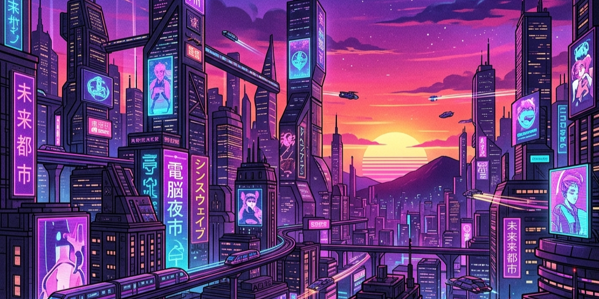

# Cyber City Light — VS Code Theme Suite



<p align="center">
  <a href="https://marketplace.visualstudio.com/items?itemName=sailorlabs-in.cyber-city-light"></a>
  <a href="https://marketplace.visualstudio.com/items?itemName=sailorlabs-in.cyber-city-light"></a>
  <a href="https://marketplace.visualstudio.com/items?itemName=sailorlabs-in.cyber-city-light"></a>
  <a href="https://vscode.dev"></a>
  <a href="LICENSE"></a>
</p>

A vibrant, highly readable Cyberpunk-inspired color theme suite for VS Code, fully supporting both desktop and web-based environments (`vscode.dev`, `github.dev`).

This theme is a lightweight, high-performance static color theme suite, redesigned to remove all browser-hacking JavaScript injection (avoiding core corruption warnings and enabling web compatibility) and expanded to include a cool light mode and two new relative dark modes.

---

## ✨ Features & Highlights

- ⚡ **100% Web IDE Compatible**: Zero executable code, lightweight bundle (~175 KB), instant loading on `vscode.dev` and `github.dev`.
- 🌈 **Rainbow Bracket Pair Colorization**: Glowing neon bracket highlights and guide lines across 6 bracket levels.
- 📜 **Editor Sticky Scroll**: Fully themed sticky headers for classes, functions, and markdown sections.
- 🧠 **Semantic Token Highlighting**: Tailored semantic coloring for TypeScript, Rust, Python, Go, and C#.
- 💡 **Inlay Hints & Testing UI**: Non-intrusive parameter hints and cyberpunk test runner icons.
- 🖥️ **Command Center & Notifications**: Modern top search bar and cyberpunk toast notifications.

---

## 🎨 The Themes

Cyber City Light comes with 4 custom-crafted color palettes designed for different times of the day and developer moods:

### 1. ☀️ Cyber City Light (Light Mode)

A cool, clean light theme utilizing a soft lavender-grey background (`#fdfcff`) combined with high-contrast, dark-neon accents. Standard neon colors are darkened just enough to satisfy accessibility and legibility rules while retaining their signature vibrant cyber-aesthetic.

### 2. 🌌 Cyber City Dark

The classic dark palette. It features the signature neon pinks, cyans, oranges, and deep indigo backgrounds that defined the original theme, now running as a standard, high-performance static color theme.

### 3. 🌇 Cyber City Dusk

A warm, sunset-themed dark mode variant. Utilizing a deep plum background (`#261a28`) with golden yellow, sunset orange, mint green, and electric blue tones. Perfect for coding as the sun goes down.

### 4. 🌃 Cyber City Midnight

An ultra-dark, high-contrast dark mode. Features a deep midnight black-purple background (`#12101f`) with glowing neon rose, lime green, and electric cyan highlights. Designed for late-night coding sessions.

---

## 🚀 Installation & Activation

1. Open **VS Code** or **[vscode.dev](https://vscode.dev)**.
2. Go to the Extensions view (`Ctrl+Shift+X` or `Cmd+Shift+X`).
3. Search for **Cyber City Light** and click **Install**.
4. Open the Command Palette (`Ctrl+Shift+P` or `Cmd+Shift+P`) and choose **Preferences: Color Theme**.
5. Select your preferred flavor:
   - `Cyber City Light`
   - `Cyber City Dark`
   - `Cyber City Dusk`
   - `Cyber City Midnight`

---

## 🌐 Full Web Compatibility

Because this extension does not use any experimental JS or CSS injection, it works seamlessly out-of-the-box on:

- **VS Code for the Web** (`https://vscode.dev`)
- **GitHub Dev** (`https://github.dev`)
- **VSCodium / Cursor / Gitpod**
- Sandboxed and enterprise environments where admin privileges are restricted.

---

## 🛠️ Customization

If you want to fine-tune the colors, you can easily override them in your VS Code `settings.json`:

```json
"workbench.colorCustomizations": {
    "[Cyber City Light]": {
        "editor.background": "#fbf9fe",
        "statusBar.background": "#dcd7eb"
    }
}
```

---

## 📝 License & Credits

- Licensed under the permissive **[MIT License](LICENSE)**.
